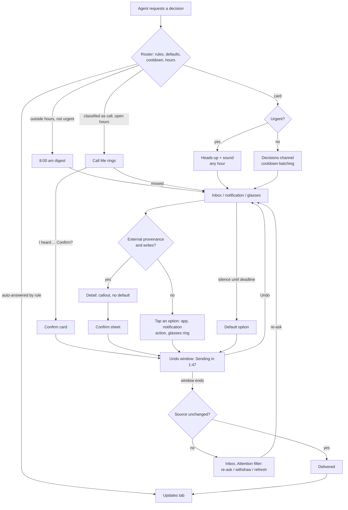

# Nod for Android: app layout and mockups

Design reference for the phase 2 Android app (Expo, see `docs/HANDOFF.md` §2 and §7). It covers the app layout, navigation, every screen and its states, notifications, the glasses handoff and Call Me. The static mockups in `mockups/` use the real design tokens, fonts, icons and web components. **Nothing in this folder ships.**

- **Settled** means it is already decided in `docs/HANDOFF.md`, the decision contract or the `add-decision-loop` specs. This doc does not re-decide those things.
- **Decided** means David chose it after the first draft of this doc (2026-11-14). See [Decided](#decided-by-david-2026-11-14).
- **Proposal** means a layout or interaction choice made here for David to confirm. Each one is marked _Proposal_; the bigger ones are repeated under [Open questions](#open-questions-for-david).

## Contents

1. [Principles](#principles)
2. [App layout and navigation](#app-layout-and-navigation)
3. [Screens and states](#screens-and-states)
4. [Answer, undo, delivered](#answer-undo-delivered)
5. [Notifications](#notifications)
6. [Quiet hours, offline, attention](#quiet-hours-offline-attention)
7. [Phone and Even G2 handoff](#phone-and-even-g2-handoff)
8. [Call Me](#call-me)
9. [Flow diagram](#flow-diagram)
10. [Decided, and open questions for David](#decided-by-david-2026-11-14)
11. [Component and token mapping](#component-and-token-mapping)
12. [Mockups and screenshots](#mockups-and-screenshots)

## Principles

Most of these carry over from the web inbox (`apps/web/public/style.css`, `design.html`).

- **Impact first.** The card and the detail lead with what changes, and for whom. Options read as outcomes. Technical evidence stays collapsed at the bottom. _Settled._
- **One green thing per screen.** Green (`accent`) marks only the logo, the primary action (the recommended option, Confirm, Send) and live or high-visibility state (the undo bar, LIVE, Sending). Everything else is gray. _Settled in the design system._
- **Effects mean "act here".** Corner brackets mark a card or panel that needs David. Scanlines appear on the undo bar and on press or focus. Urgent swaps the green brackets for red ones and adds a red edge. _Settled in the design system._
- **Square Nod, round Android.** Nod's own UI has square corners. The Android chrome (notification shade, heads-up, lock screen) keeps its rounded system shapes, so it is always clear what is Nod and what is the OS.
- **The phone lock is the approval gate.** Answering in the app or on the glasses is enough, with no biometric step. _Settled._
- **Outside input never gets a shortcut.** If a decision with external provenance writes anything, it is answered only in the detail screen, after an explicit confirm. _Settled (contract and HANDOFF §2); the confirm sheet is a Proposal._

## App layout and navigation

```
┌──────────────────────────────┐
│ status bar (Android)         │
├──────────────────────────────┤
│ NOD   ▮LIVE   [glasses] [☎]  │  app bar: wordmark, connection, glasses state, Call Me
├──────────────────────────────┤
│                              │
│  tab content (scrolls)       │
│                              │
├──────────────────────────────┤
│  Inbox    Updates  Settings  │  bottom navigation, 3 tabs, labels always on
├──────────────────────────────┤
│ gesture bar                  │
└──────────────────────────────┘
```

**Three tabs plus a stack.** _Decided (tab set, 2026-11-14); the rest is Proposal._

| Level           | What                                                                                                                    | Why                                                                                                                                                                                                            |
| --------------- | ----------------------------------------------------------------------------------------------------------------------- | -------------------------------------------------------------------------------------------------------------------------------------------------------------------------------------------------------------- |
| Bottom tabs (3) | **Inbox** (decisions, plus the items that need attention), **Updates**, **Settings**                                    | Stale & conflicts lives inside Inbox (decided 2026-11-14), so everything David has to act on is in one place. Settings is a tab because pairing, theme, channels and glasses state get checked often at first. |
| Stack screens   | **Decision detail**, **Confirm sheet** (external writes), **In-call**, **Pairing**                                      | Opening a decision pushes onto the stack. Back, or the system back gesture, returns to the same scroll position in the list.                                                                                   |
| App bar actions | Connection (LIVE or OFFLINE), glasses state (icon only when paired), **Call Me** (a square button, always one tap away) | Call Me with no decision open starts **task-creation mode** (HANDOFF §6).                                                                                                                                      |
| Deep links      | `nod://decision/<id>` from notifications, the glasses ("open on phone") and Call Me                                     | A notification tap always lands on the detail screen, never on the list.                                                                                                                                       |

Badges: the Inbox tab carries two. Green is how many decisions need David. Amber, next to it, is how many items need attention (repair). The amber count stays visible from every tab, so a failed delivery is never hidden behind a filter. Updates and Settings have no badge, so the badges never turn into noise.

## Screens and states

Every screen exists in dark and light. Theme follows the system by default, with a System / Light / Dark switch in Settings (the same three modes and `nod.theme` meaning as the web toggle).

### Inbox (tab)

- **Content:** decisions that need an answer, then answered ones still in their undo window. Order follows the web `sortInbox`: urgent first, then oldest deadline. _Settled ordering._
- **Card:** tags (Urgent, From external, Answered, source system · agent), glance title (≤ 48 chars), question (≤ 120 chars), and a live line ("Sending "Merge" in 1:47") while an answer is in its undo window. No options on the card: the list is for triage, and the detail is where David answers. _Proposal._
- **Filter chips** under the heading: **All**, **Needs you**, and an amber **Attention** chip (only when there is something to repair). _Proposal, following the 2026-11-14 decision._
- **Attention row:** when anything needs repair, one amber row sits above the decisions: "3 need attention · Changed since you looked · delivery failed · queued", with **Review**, which selects the Attention chip. Attention items don't mix into the decision list, because they need a different kind of action (repair, not a choice). _Proposal._
- **States:**
  - normal list, with or without the attention row
  - **Attention filter**: only repair items (next section)
  - empty: the "All clear" illustration, with the next digest time
  - quiet hours: a strip above the list, "Quiet hours until 8:00 am. Only urgent decisions alert you."
  - offline: a red banner, cached cards dimmed, answering disabled
  - loading: the cached list stays visible, with the LIVE marker off until the SSE stream reconnects
- **Gestures:** pull to refresh. No swipe-to-answer: an answer from a list row skips the impact text. _Proposal._

### Decision detail (stack)

The layout follows the web detail, top to bottom:

1. Tags.
2. Title.
3. **Impact**: the lead paragraph, set larger than body text.
4. **Your call**: one full-width button per option (2–4). The recommended option is the green primary and carries a ★ Recommended chip. The others are outlined gray. Each button shows the option's outcome; a write adds "(changes something)" or a more specific "(sends email)".
5. Default line: "If you say nothing: Run tonight, in 18 min". Overnight it reads "paused until 8:00 am". _Settled behavior._
6. Freshness: "Checked 40s ago" with a Refresh button. Past the reconciler interval (5 min) the line turns amber. _Settled._
7. Technical evidence, collapsed, with a count.
8. A **bottom dock** with **Other answer** (opens a text field with dictation, the `mic` icon; shown when `allow_other`) and **Talk it through** (Call Me about this decision; shown when `allow_call` and in open hours). _Proposal: the dock keeps both in thumb reach without crowding the options._

States: open, answered (undo), sending, delivered, held, changed since you looked, failed, withdrawn or agent stopped. They reuse the web banners (`banner.undo`, `.sending`, `.done`, `.held`, `.stale`, `.failed`).

### External provenance (stack)

- An amber callout under the impact: "From outside: sales@acme-print.com. Every option sends an email. Nod never answers this for you: no default, no rules, no one-tap answer from a notification." _Settled rule; Proposal wording._
- **No green option.** The recommendation is still marked with ★, but every option stays outlined, so the eye doesn't land on a pre-picked answer. _Proposal._
- Tapping an option opens a **confirm sheet**: the option, the recipient, a preview of what will be sent (when the source supplies one as evidence), then Cancel and a green **Send reply**. The 2-minute undo still applies after this. _Proposal._

### Inbox: Attention filter (was the Stale tab)

The HANDOFF §5.9 "Stale & conflicts" queue, shown as an Inbox filter. One card per problem, each with an amber left edge, its banner and its repair actions:

| Problem                                      | Banner                                                        | Actions                     |
| -------------------------------------------- | ------------------------------------------------------------- | --------------------------- |
| Changed since you looked (fingerprint moved) | red `stale` banner: "Changed since you looked: QA now 47/47"  | Re-ask, Withdraw            |
| Delivery failed                              | red `failed` banner with the source's reason; "Tried 3 times" | Retry, Force refresh        |
| Queued behind a resource lock                | amber `held` banner: "Queued behind the refund migration"     | Open (read-only until free) |
| Agent stopped (TTL expired)                  | gray: "Agent stopped 12 min ago"                              | Withdraw, Re-ask            |
| Resolved outside Nod                         | gray: "Resolved outside Nod"                                  | Dismiss                     |

### Updates (tab)

- Top: the latest **sweep summary** (every 2 h, 8 am–8 pm) as a plain panel, with the next sweep time in the section head. _Settled cadence._
- Then a history list: delivered answers, defaults that ran, scheduled work, agent reports, with source · agent · time on each row. The **8:00 am digest** and the **end-of-day digest** appear as rows and open full screen.

### Settings (tab)

| Group           | Rows                                                                                                                                              |
| --------------- | ------------------------------------------------------------------------------------------------------------------------------------------------- |
| This phone      | Paired with nod-core (device name, last four characters of the token, Re-pair, Sign out). Theme: System / Light / Dark.                           |
| Notifications   | One row per channel (below), each opening the Android channel settings. **Open hours**: "8:00 am – 8:00 pm Phoenix · set on server", read-only.   |
| Devices & voice | **Even G2 glasses** (connected, R1 ring paired, Pair or Forget). **Call Me** (on or off, open hours only, spend this month against the hard cap). |
| Delivery        | **Delivery mode**: Live or Dry run, read-only, mirrors `NOD_DELIVERY_MODE`. When it's dry run, a gray strip shows on every screen.                |

The per-type undo delay is set on the server. It shows read-only in the decision detail as the length of the undo bar. _Proposal: no editing on the phone in phase 2._

### Pairing / sign-in (first run)

_Decided (David, 2026-11-14):_ **QR is the primary path; token paste is the fallback.**

- **Scan a QR code** that the desk web app shows. **This needs a new core pairing endpoint, to be built in a later PR.** Phase 1 core doesn't have one.
- **Paste a device token** ("No camera? Paste a device token"). This works today, with the same `NOD_DEVICE_TOKEN` flow as the web sign-in.

Intended flow (the API is not designed here):

1. On the desk, David opens the web app → **Settings → Pair a phone**. The web app, already signed in, asks core for a short-lived, single-use pairing code and shows it as a QR.
2. The phone app scans the QR and sends the code to core.
3. Core issues a new device token for this phone and returns it. The phone stores it. The desk page shows "Paired: Pixel 9" and the code expires.

Open details for the endpoint PR: code lifetime, one token per device (so one phone can be revoked alone), and how revocation shows in Settings.

The screen uses the sign-in illustration, a numbered two-step guide, and a decorative QR in a bracketed frame. The token is kept in Android's encrypted storage (expo-secure-store).

### Empty

The `illo-empty` illustration, the pixel heading "ALL CLEAR", one line on what is waiting, and a link to Updates. During quiet hours the quiet strip appears above it.

## Answer, undo, delivered

_Settled behavior; this section only describes how it looks._

1. David taps an option. The detail swaps the options for **Your answer** (a check and the outcome). An **undo bar** docks at the bottom: green-tinted, with brackets and scanlines, "Sending in 1:47", an **Undo** button, and a draining dotted meter.
2. The list card shows "Sending "Merge" in 1:47" in green, and the notification turns into a **Sending** notification with a progress bar and one **Undo** action.
3. When the window ends, core re-checks the source:
   - unchanged: **Sending**, then **Delivered** (a check banner, then the item moves to Updates)
   - changed: **Changed since you looked**, and the item moves to Inbox → Attention
4. **Undo** returns the decision to open with the same options. Undo is never more than one tap away while the bar is visible, on the phone, in the notification, and on the glasses (double tap).

## Notifications

### Channels

_Proposal._ Android channels are user-tunable, so Nod uses few, with clear purposes:

| Channel               | Importance                     | Used for                                                                                         | Hours                       |
| --------------------- | ------------------------------ | ------------------------------------------------------------------------------------------------ | --------------------------- |
| **Urgent**            | High: heads-up, sound, vibrate | `urgency: urgent`; bypasses cooldown                                                             | Any hour (settled)          |
| **Decisions**         | Default; quieter when batched  | Everything else that needs an answer. The first alerts, the rest batch under cooldown (settled). | Open hours; then the digest |
| **Sending**           | Low, ongoing                   | The undo window: progress plus Undo                                                              | Any hour                    |
| **Updates & digest**  | Low, silent                    | Sweep summaries, the 8:00 am digest and the end-of-day digest                                    | Open hours                  |
| **Delivery problems** | Default                        | Failed delivery, changed since you looked, agent stopped                                         | Open hours                  |

### Content and actions

- **Title** = glance title. **Text** = the question, or the default ("If you say nothing: Run tonight, in 18 min").
- **One-tap answers for internal decisions.** _Decided (David, 2026-11-14)._ Android allows up to 3 actions: the top 2 options (the recommended one first; labels are ≤ 20 chars, so they fit), then **Open**. A decision with more options still shows the top two and Open.
- **External provenance: no inline answer.** The only action is **Review in Nod**, which opens the detail. The text says why ("Every option sends an email, so answer it in Nod."). _Settled rule._
- **Inline answer → undo.** _Decided._ An inline tap answers right away, and the notification turns into a **Sending** notification with a progress bar and **Undo**, the same 2-minute window.
- **Grouping:** batched decisions collapse into one summary ("2 more decisions") in the Decisions channel.
- **Lock screen:** title and text are visible (the visibility is "public": the content is David's own and impact-first). Actions show, but answering asks for unlock (`authenticationRequired`), because the phone lock is the gate. _Still open; see the open questions._
- **Heads-up:** only the Urgent channel pops over other apps.
- **Wear OS:** the same notification and actions bridge to the watch. No extra watch UI in phase 2. _Settled scope._

## Quiet hours, offline, attention

- **Quiet hours** (8 pm–8 am Phoenix, set on the server): non-urgent decisions don't notify. The Inbox shows the quiet strip, default countdowns read "paused until 8:00 am", and Call Me is disabled with the reason ("Calls are open 8 am–8 pm"). _Settled behavior._
- **Offline:** the app keeps the last list it had (TanStack Query cache) and marks it with a red OFFLINE marker and banner: "Offline since 9:38. Showing what you had then." **Answering is disabled offline**, because the undo clock and the source check run on the server. _Proposal; queueing answers offline is an open question._
- **Freshness:** each detail shows "Checked 40s ago". Past 5 min it turns amber and offers Refresh. _Settled._

## Phone and Even G2 handoff

_Settled:_ the glasses show the glance card, the default highlighted with a draining countdown ring, and the R1 ring (swipe = move, tap = select, double tap = skip, long press = Call Me on the phone). The display is 576×288, monochrome green.

_Proposal_ for how the two surfaces share one decision:

- **One active surface.** When the glasses are worn and connected, a new decision goes to the glasses first. The phone notification posts silently, with the text "On your glasses". Urgent decisions alert on both.
- In the app, the open decision shows an **"On your glasses now"** panel with a live preview of the G2 screen (black, green, options, ring). It has two actions: **Answer here instead** and **Dismiss on glasses**.
- An answer from either surface updates both through SSE: "Answered on glasses: Run tonight", then the same undo bar on the phone, plus a "Sending 1:47 · double tap to undo" line on the glasses.
- A **long press** on the ring starts Call Me on the phone, about the decision on screen.

## Call Me

_Settled:_ calls run in open hours only; ConnectionService shows a real in-call UI; voice never commits; `report_decision` creates an "I heard: … Confirm?" card; one tap confirms; then the undo window applies. A missed call becomes a card.

In-call screen (_Proposal_ layout):

- A label with the elapsed time ("Call Me · 2:14"), a pixel waveform, and the decision it is about.
- A live transcript (You / Nod).
- The **I heard** card, bracketed, with **Not that** and a green **Confirm**. It also posts as a normal decision card, so it can be confirmed after hanging up.
- Mute (mic) and a red End button.
- Started from the app bar with no decision open, it is **task-creation mode**. The I-heard card then reads "New task for <project> · <agent>. Confirm?"

## Flow diagram



The "silence until deadline" path never applies to external writes: the contract forbids defaults that write for external provenance.

## Decided by David (2026-11-14)

1. **Navigation: Stale folds into Inbox.** Three tabs: Inbox · Updates · Settings. Repair items show as an amber attention row and an **Attention** filter chip in Inbox. The amber count rides on the Inbox tab badge.
2. **One-tap answers from notifications, for internal decisions.** Top 2 options plus Open; an inline answer turns into the Sending notification with Undo. External-provenance decisions never get inline answers (AGENTS.md rule).
3. **Pairing: QR first, token paste as fallback.** Needs a new core pairing endpoint, built in a later PR.

## Open questions for David

Each has the default this doc recommends. The mockups show the recommended default.

1. **Lock screen:** require unlock to answer, or allow answering from the lock screen since the undo window exists? Full text, or only "Nod: 1 urgent decision"? **Recommended:** full text visible; answering requires unlock.
2. **External decisions:** is the extra confirm sheet wanted, or is "no default, no inline answer" enough? **Recommended:** keep the confirm sheet, since these writes leave the company.
3. **Glasses priority:** when the glasses are on, should non-urgent decisions go to the glasses only, with a silent phone notification? **Recommended:** yes; urgent alerts on both.
4. **Offline answers:** queue them and send on reconnect (the undo window then starts late), or disable answering offline? **Recommended:** disable answering offline.
5. **Call Me from the app bar:** always visible as a task-creation shortcut, or only inside a decision? **Recommended:** always visible (disabled outside open hours).
6. **Haptics:** a distinct vibration pattern for urgent, and a short tick when the undo window ends? **Recommended:** yes to both.
7. **Undo length per type:** show the configured length ("Undo window: 5 min for deploys") in the detail, or just let the bar show it? **Recommended:** the bar only; no extra text.

## Component and token mapping

Mapping from the web design system (`packages/design-tokens`, `apps/web/public/style.css`) to the planned Expo stack: NativeWind and react-native-reusables. The token values are the same. Only the delivery changes: `tokens.json` should gain a generated NativeWind/Tailwind theme (`--color-*` → `colors`, spacing → `spacing`, type → `fontSize`), next to `tokens.css`, the same way `generate.mjs` already emits CSS and JS.

| Mockup / web class                            | React Native component (proposed)                                                     | Tokens                                                                            |
| --------------------------------------------- | ------------------------------------------------------------------------------------- | --------------------------------------------------------------------------------- |
| `.appbar`, `.wordmark`                        | `AppBar` with a `PixelText` wordmark (SVG from `pixelText()` in `@nod/design-tokens`) | `bg`, `line`, `accentInk`, `effect.glow`                                          |
| `.bottomnav`, `.navbadges`                    | Expo Router `Tabs` with a custom `TabBar`                                             | `text`, `textDim`, `accent`/`onAccent` (inbox badge), `amber` (attention badge)   |
| `.card`, `.needs-you`, `.urgent`              | `DecisionCard` (Pressable)                                                            | `surface`, `line`, `accentInk` brackets, `red` edge and brackets, `border.accent` |
| `.tag.*`                                      | `Tag` (variants: urgent, external, write, sending, source)                            | `red`/`onRed`, `amber`, `accentInk`, `line`                                       |
| `.btn.option`, `.btn.primary`, `.rec`         | `OptionButton` (primary when recommended and not external)                            | `accent`, `onAccent`, `lineStrong`, `size.control`                                |
| `.banner.undo`, `.meter`                      | `UndoBar`, docked (Reanimated for the meter)                                          | `accentDeep`, `accentInk`, scanline pitch                                         |
| `.chips`, `.attn-strip`                       | reusables `ToggleGroup` as filter chips; `AttentionRow` (Pressable)                   | `text`/`bg` (selected chip), `amber`, `amberDeep`                                 |
| `.banner.held/.stale/.failed`                 | `StatusBanner`                                                                        | `amber`/`amberDeep`, `red`/`redDeep`                                              |
| `.callout`                                    | `ProvenanceCallout`                                                                   | `amber`, `amberDeep`                                                              |
| `.sheet`, `.scrim`                            | Bottom sheet (`@gorhom/bottom-sheet` or the reusables `Dialog`)                       | `surface`, `lineStrong`                                                           |
| `.list-group`, `.list-row`, `.switch`, `.seg` | reusables `Switch`, `ToggleGroup`, a plain `ListRow`                                  | `surface`, `line`, `accent`                                                       |
| `.empty`, `.illo`                             | `EmptyState` with `PixelIllustration` (two-ink SVG from `illustrations`)              | `textDim`, `accentInk`                                                            |
| `.icon icon-*`                                | `PixelIcon name=` rendering the 12x12 grids from `icons`                              | `currentColor`                                                                    |
| `.g2-screen`, `.ring`                         | `GlassesPreview` (the same layout code as the Even Hub app, if shared)                | `glassesLevel()`; pure green on black                                             |
| `.call`, `.transcript`, `.round`              | `CallScreen` (ConnectionService handles the system UI; this is the in-app view)       | `accentInk` wave, `red` end                                                       |
| Notifications                                 | Notifee or expo-notifications with channels, actions and `authenticationRequired`     | The small icon is the app icon from `appIcon`; the accent colour `accent`         |

New icons added for mobile: `call`, `glasses`, `gear`, `mic` (in `packages/design-tokens/icons.json`, 31 icons in total).

Effects on native: brackets are four absolutely positioned 8×2 views. Scanlines are a repeating 3px gradient image (`expo-linear-gradient`). Glow is a shadow on Android 12+ and is skipped below that. Reduced motion drops the scanlines and the glow, as on the web.

## Mockups and screenshots

```
mockups/
  index.html    every screen on one page (the contact sheet)
  screen.html   one phone: screen.html?s=<id>&t=dark|light
  mockups.js    sample data and screen builders (fictional data)
  mobile.css    phone frame, Android chrome, mockup-only layout
screenshots/    PNGs at 390x844, @3x, plus 00-contact-sheet.png
```

ES modules don't load from `file://`, so serve the repo root to view them:

```sh
python3 -m http.server 8765
# http://localhost:8765/docs/design/mobile/mockups/index.html
# http://localhost:8765/docs/design/mobile/mockups/screen.html?s=detail&t=light
```

Screen ids: `inbox`, `detail`, `undo`, `external`, `attention`, `updates`, `settings`, `onboarding`, `empty`, `offline`, `shade`, `headsup`, `lock`, `glasses`, `call`.

| Screenshot                                  | Shows                                                                                        |
| ------------------------------------------- | -------------------------------------------------------------------------------------------- |
| `00-contact-sheet.png`                      | All screens                                                                                  |
| `01-inbox-dark.png`, `02-inbox-light.png`   | Inbox: filter chips, amber attention row, urgent first, an answered card sending             |
| `03-detail-dark.png`, `04-detail-light.png` | Detail: impact, options with the recommended one in green, default, freshness, dock          |
| `05-undo-dark.png`, `06-undo-light.png`     | Answered; the undo bar docked                                                                |
| `07-external-dark.png`                      | External provenance: callout, no green option, confirm sheet                                 |
| `08-attention-dark.png`                     | Inbox, Attention filter: changed, failed, queued behind a lock                               |
| `09-updates-dark.png`                       | Updates: sweep summary and history                                                           |
| `10-settings-dark.png`                      | Settings                                                                                     |
| `11-onboarding-dark.png`                    | Pairing: QR first, token paste fallback                                                      |
| `12-empty-dark.png`                         | All clear during quiet hours                                                                 |
| `13-offline-dark.png`                       | Offline                                                                                      |
| `14-shade-dark.png`, `15-shade-light.png`   | Notification shade: urgent with actions, Sending with Undo, external with Review only, batch |
| `16-headsup-dark.png`                       | Urgent heads-up over another app                                                             |
| `17-lock-dark.png`                          | Lock screen: answering needs unlock                                                          |
| `18-glasses-dark.png`                       | Glasses handoff, with a G2 preview                                                           |
| `19-call-dark.png`                          | Call Me in progress, with the I-heard confirm                                                |

To regenerate the screenshots, use Playwright (Chromium). Use a 390×844 viewport at device scale factor 3, wait for `body[data-ready="1"]` and `document.fonts.ready`, then screenshot the `.phone` element.
